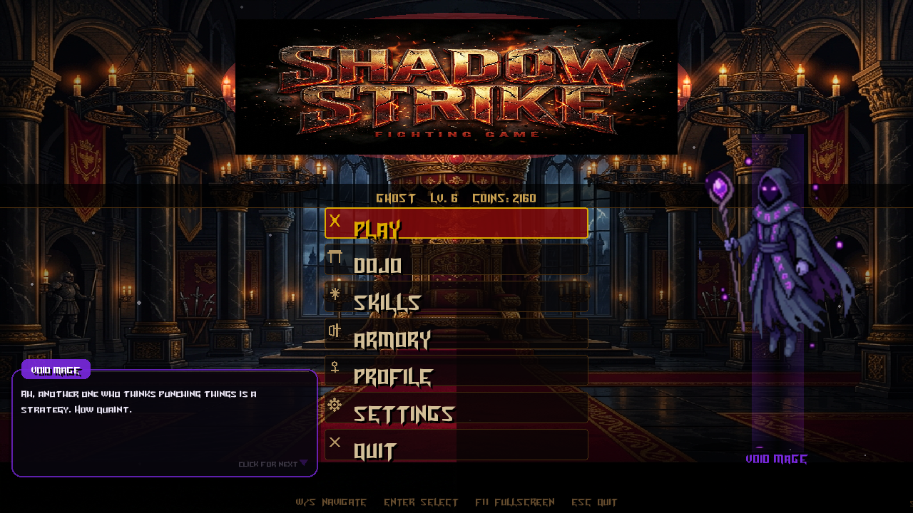

# Shadow Strike 🥋

**A dark-fantasy 2D arcade fighting game with RPG progression, built from scratch in Python + Pygame.**

Pick one of 10 fighters, battle the CPU or a friend on the same keyboard, earn coins and XP, unlock new moves in the Skill Tree, gear up in the Armory, and train in a physics-based Dojo.



## ⬇️ Play it now

1. Open the **[latest release](https://github.com/Anonymous-Hecker/shadow_strike/releases/latest)**.
2. Download `ShadowStrike-windows.zip` (or `ShadowStrike-linux.zip`).
3. Unzip it and run **`ShadowStrike.exe`** (Windows) or **`./ShadowStrike`** (Linux). No Python needed.

> **Windows SmartScreen:** the exe isn't code-signed, so Windows may say *"Windows protected your PC"*. Click **More info → Run anyway**.
>
> **Saves & crash reports:** progress is stored in `%APPDATA%\ShadowStrike` (Windows) or `~/.local/share/ShadowStrike` (Linux). If the game ever closes unexpectedly, the reason is written to `crash.log` in that folder.

Prefer to run from source? See [Run from source](#-run-from-source).

## 🌟 Features

* **10 unique fighters** in 5 classes (Warrior, Rogue, Mage, Guardian, Shadow): Warlord, Berserker, Shadowblade, Kage, Void Mage, Wraith, Ironclad, Iron Monk, The Shadow and Oni Blade. Each has its own stats, attack ranges and critical-hit trait. Stronger fighters unlock as you level up.
* **Combat system:** light, heavy, special and super attacks, blocking, dash strike, counter strike, ground slam and a **sweep** that disarms and stuns. Chain hits into combos for bonus damage.
* **Single player or local 2-player:** fight the CPU on **5 difficulty levels**, or share one keyboard. Matches are best of 3 rounds, 99 seconds each.
* **Skill Tree:** spend your progress across four tiers (Novice → Adept → Master → Shadow) to unlock Dash Strike, Sweep, Counter Strike, Ground Slam, Special Move, Ultra Hit, Shadow Step and Rage Form.
* **Armory:** buy and equip weapons and armor with the coins you win.
* **Physics-based Dojo:** a training hall with a punching bag that swings like a real pendulum, reacting to how hard you hit.
* **Fighters that talk back:** the main menu shows your favourite fighter, who chats with you in a typewriter-style dialogue box, reacts to your stats and tells you when the next fighter in their class is ready to unlock.
* **Atmosphere:** moody arenas with particle effects, and **all music and sound effects are generated in code** at startup, so there are no audio files.

## 🎮 Controls

| Action | Player 1 | Player 2 |
|---|---|---|
| Move left / right | `A` / `D` | `←` / `→` |
| Jump | `W` | `↑` |
| Light attack | `J` | `Numpad 1` |
| Heavy attack | `K` | `Numpad 2` |
| Special | `L` | `Numpad 3` |
| Super | `U` | `Numpad +` |
| Block | `;` | `Numpad 0` |
| Dash strike *(skill)* | `F` | `Numpad 4` |
| Counter strike *(skill)* | `G` | `Numpad 5` |
| Ground slam *(skill)* | `H` | `Numpad 6` |
| Sweep *(skill)* | `N` | `Numpad 7` |

Skill moves must be unlocked in the **Skill Tree** first. Menus: `W`/`S` or the mouse to navigate, `Enter` to select. `F11` toggles fullscreen. Controls can be changed in **Settings**.

## 🐍 Run from source

Requires Python 3.10+.

```bash
git clone https://github.com/Anonymous-Hecker/shadow_strike.git
cd shadow_strike
pip install -r requirements.txt
python main.py
```

### Building the release yourself

* **Windows (local):** run `.\build_windows.ps1`, which produces `release\ShadowStrike-windows.zip`.
* **Automatic (Windows + Linux):** pushing a version tag makes GitHub Actions build both and attach them to a Release:
  ```bash
  git tag v1.0.0
  git push origin v1.0.0
  ```

## 🛠️ Technical highlights

### Sprite transparency (the "Ghost" bug)
The character sprites are AI-generated sheets whose backgrounds are gradients and noise, not clean green-screen. Simple colour-keying left ugly borders, and threshold-based removal hollowed out dark armour so fighters looked like ghosts. The fix is a **connected-component flood fill** (`scipy.ndimage`): sample the corners of each animation cell and remove only the background-coloured pixels that connect to the cell's edge, so the character's body acts as a wall and stays intact.

### Facing logic
Early builds made fighters face the way they walked, so backing away turned your back on the enemy. Movement and facing are now decoupled: every frame the fighter faces its opponent.

### State machines
Each fighter runs on a state machine (`idle`, `walk`, `jump`, `attack_light`, `hurt`, `dead`, …) so you can't attack while stunned or jump while dead.

### Procedural audio
Every sound effect and the battle music are synthesised with NumPy at launch (sine/square/noise with envelopes), including the dialogue box's typewriter tick, so the game ships with zero audio assets.

### Packaging
Shipped with PyInstaller. Read-only assets are bundled, while saves and crash logs go to a per-user folder so progress survives updates. GitHub Actions builds Windows and Linux releases from a version tag.

## 📓 Devlogs

The full development story, including the bugs, is in [DEVLOGS.md](DEVLOGS.md).
